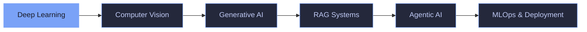

# 👋 Hi, I'm Amrit Preetam Nayak

### 🤖 AI/ML & Data Science Enthusiast | Python | Machine Learning | Deep Learning

  
  
  

  <a href="#about">About</a> •
  <a href="#stack">Tech Stack</a> •
  <a href="#projects">Projects</a> •
  <a href="#learning">Learning</a> •
  <a href="#stats">GitHub Stats</a> •
  <a href="#goals">Goals</a> •
  <a href="#connect">Connect</a>

I'm a **B.Tech Information Technology student** passionate about Artificial Intelligence, Machine Learning, Data Science, and building real-world technology solutions.

I enjoy turning ideas into practical applications using **Python, Machine Learning, Deep Learning, Data Analytics, and modern development tools.**

## 🧑‍💻 About Me

- 🎓 B.Tech Information Technology Student · Class of 2028 (OUTR)
- 🤖 AI/ML & Data Science Enthusiast
- 🐍 Python & C++ Programmer
- 📊 Interested in Data Analytics & Machine Learning
- 🧠 Currently learning Deep Learning
- 🚀 Building real-world AI/ML projects
- 💡 Interested in Generative AI, MLOps & Agentic AI
- 💼 Open to AI/ML, Data Science & Software Development opportunities

## 🛠️ Tech Stack

<table>
  <tr>
    <td width="170"><b>👨‍💻 Programming</b></td>
    <td>
       
      <code>Python</code> <code>C++</code> <code>JavaScript</code> <code>SQL</code>
    </td>
  </tr>
  <tr>
    <td><b>🤖 AI / Machine Learning</b></td>
    <td>
       
      <code>NumPy</code> <code>Pandas</code> <code>Scikit-learn</code>
    </td>
  </tr>
  <tr>
    <td><b>📊 Data Visualization</b></td>
    <td>
       
      <code>Matplotlib</code> <code>Seaborn</code> <code>Plotly</code>
    </td>
  </tr>
  <tr>
    <td><b>🌐 Development</b></td>
    <td>
       
      <code>React</code> <code>Node.js</code> <code>FastAPI</code> <code>Streamlit</code> <code>Flask</code>
    </td>
  </tr>
  <tr>
    <td><b>🗄️ Database & Tools</b></td>
    <td>
       
      <code>MySQL</code> <code>SQLite</code> <code>Git</code> <code>GitHub</code> <code>Jupyter Notebook</code> <code>VS Code</code>
    </td>
  </tr>
  <tr>
    <td><b>🌱 Learning / exploring</b></td>
    <td><code>TensorFlow</code> <code>PyTorch</code> <code>MongoDB</code> <code>Docker</code> <code>MLOps</code></td>
  </tr>
</table>

## 🚀 Featured Projects

### 🩺 Med Recognition  

> **An intelligent multimodal clinical analysis system utilizing Google Gemini Vision to analyze prescriptions, scans, and diagnostic imagery.**

- 🎯 **Problem:** Medical prescriptions, diagnostic scans (X-ray, MRI, CT), and clinical slips are difficult to transcribe manually and prone to interpretation delays.
- 🧠 **Approach:** In-memory stream processing with dual-stage medical guardrails and dynamic model negotiation across Google Gemini Vision models.
- 🛠️ **Stack:** <code>Python</code> <code>Flask</code> <code>Google Gemini API</code> <code>Pillow</code> <code>HTML5/CSS3</code>
- 📈 **Result:** In-memory zero-disk pipeline with dual-stage non-medical guardrail filtering and automated prescription dosage extraction.
- 🔗 [View Project](https://github.com/amrit0012vr/Med-recognition)

 

### ⚖️ NyayaFlow  

> **An open-source, privacy-first judicial decision-support platform for case triage, brief generation, and free legal aid.**

- 🎯 **Problem:** Indian courts carry a 50.4M+ case backlog and 434K+ undertrial prisoners, slowed by manual docketing and unstructured filings.
- 🧠 **Approach:** Multi-agent architecture with role-based portals, automated statutory urgency scoring, citation-verified bench briefs, and OR-Tools scheduling.
- 🛠️ **Stack:** <code>Python</code> <code>FastAPI</code> <code>React</code> <code>TypeScript</code> <code>SQLAlchemy</code> <code>Google OR-Tools</code> <code>Tailwind CSS</code>
- 📈 **Result:** 0.998 Spearman rank correlation on triage, 100% negative test suite pass on citations, and 75% wait time reduction for critical hearings.
- 🏅 *Built for Bharat Agentic-AI Hackathon 2026 (Track 07 — Timely Justice: Legal Backlog)*
- 🔗 [View Project](https://github.com/amrit0012vr/Nyayaflow)

 

### 🌊 Flash Flood Prediction  

> **A machine learning system for predicting flash-flood risk levels using environmental and simulated IoT sensor data.**

- 🎯 **Problem:** Flash floods develop rapidly; vulnerable communities lack localized real-time risk assessment before disaster strikes.
- 🧠 **Approach:** Random Forest classifier trained on rainfall, soil moisture, and hydrological features, deployed via FastAPI with a Streamlit GIS dashboard.
- 🛠️ **Stack:** <code>Python</code> <code>Scikit-learn</code> <code>FastAPI</code> <code>Streamlit</code> <code>Folium</code> <code>Pandas</code> <code>NumPy</code> <code>Plotly</code>
- 📈 **Result:** 85.67% model accuracy with real-time risk severity mapping (Low/Medium/High) and simulated live sensor telemetry.
- 🔗 [View Project](https://github.com/amrit0012vr/Flash_Flood)

## 🧠 Currently Learning

🔵 in progress &nbsp;·&nbsp; dark = up next

## 📚 Areas of Interest

🤖 Artificial Intelligence &nbsp;•&nbsp; 🧠 Machine Learning &nbsp;•&nbsp; 🔬 Deep Learning &nbsp;•&nbsp; 📊 Data Science &nbsp;•&nbsp; 📈 Data Analytics 
👁️ Computer Vision &nbsp;•&nbsp; 💬 Generative AI &nbsp;•&nbsp; 🔎 RAG & LLM Applications &nbsp;•&nbsp; ⚙️ MLOps &nbsp;•&nbsp; 🌐 AI-powered Applications

## 📊 GitHub Analytics

 

 

## 💻 Coding Profiles

## 🎯 Goals for 2027

- 🚀 Build production-ready AI/ML projects
- 🧠 Master Deep Learning
- 💬 Build GenAI & RAG applications
- ⚙️ Learn MLOps & model deployment
- 🏆 Contribute to open-source projects
- 💼 Secure an AI/ML or Data Science internship
- 📈 Improve DSA & problem-solving skills

## 🤝 Let's Connect

  
  

 

### 💡 "Building intelligent solutions, one project at a time."

⭐ **If you find my projects interesting, consider giving them a star!**

